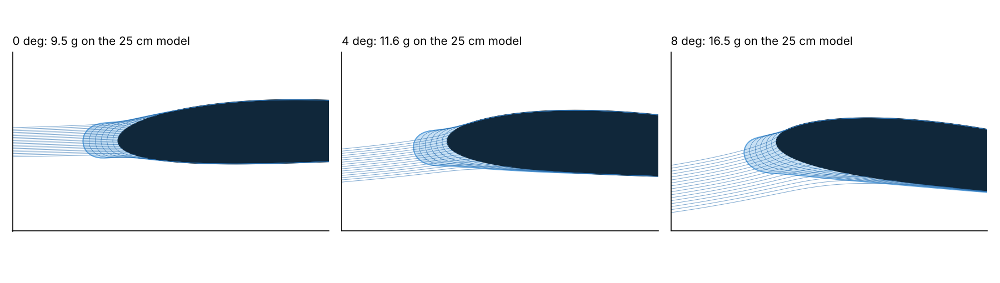
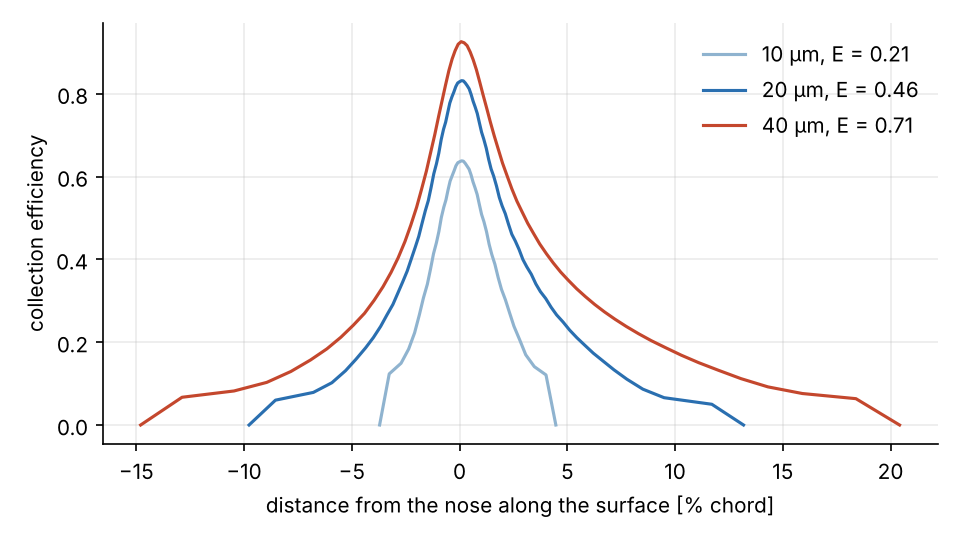
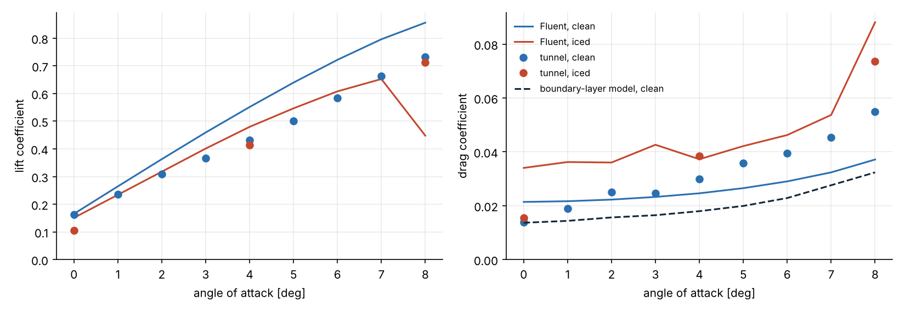

# Rime icing on an airfoil

Ice accretion on a NACA 2412 section and its aerodynamic penalty, computed from
the flow field up:

| Step | Model |
|---|---|
| Airflow | Hess-Smith panel method (source panels, one vortex strength, Kutta condition) |
| Droplets | Lagrangian trajectories with Schiller-Naumann drag, giving the local collection efficiency |
| Ice | Rime growth along the surface normal in layers, flow and trajectories recomputed on each new shape, mass conserved |
| Drag | Integral boundary layer: Thwaites, Michel transition, Head, Squire-Young |

**Interactive simulator:** https://veloyfernandes.com/icing/



## Background

The repository grew out of a 2024 group project at Aalborg University Esbjerg,
*CFD and Experimental Analysis of the Ice Accretion Effects on Wind Turbine
Performance* (group FPS-1: Aung Kyawo, Denizhan Arslanbek, Veloy Fernandes and
Zahra Bohlooli Zanjani, supervised by Matthias Mandø). The project generated
rime ice shapes with Ansys FENSAP-ICE, simulated clean and iced sections in
Ansys Fluent and tested 3D-printed models in the department's open wind tunnel:
9 cm chord, 25 cm span, 20 m/s.

The code here is my own later work. It replaces the commercial icing solver with
models written from first principles, uses them to check the project's icing
run, and re-reads the project's lift and drag data. The data tables are in
[`icing/report_data.py`](icing/report_data.py); the report itself is not
included.

## Results

Icing case of the project: 20 µm droplets, 1 g/m³, −25 °C, 7 minutes.

| Angle | Collection efficiency | Ice mass on the 25 cm model, one step | six layers | FENSAP-ICE |
|---|---:|---:|---:|---:|
| 0° | 0.46 | 10.6 g | 9.5 g | 10.24 g |
| 4° | 0.49 | 12.0 g | 11.6 g | |
| 8° | 0.48 | 16.6 g | 16.5 g | |

The ice mass of the commercial solver is reproduced to within about 3%. Growing
the ice in layers catches a little less, because the blunter ice nose deflects
more droplets.



### Re-reading the project data



1. **Clean drag at 0°.** Fluent with SST k-ω gives 0.0214; the tunnel measured
   0.0139. At a Reynolds number of 120,000 much of the boundary layer is
   laminar, and a model that is turbulent from the nose overstates friction.
   The boundary-layer model here, with free transition, gives 0.0137.
2. **Lift slope.** The tunnel model has a slope of 0.067 per degree, the
   simulation 0.097. The simulated domain is an extruded section with no tips;
   the model is a wing of aspect ratio 2.8, for which lifting-line theory gives
   0.059. The measurement lies between, and the tip vortices also explain the
   higher measured drag at high angles. The report attributed the gap to the
   turbulence model.
3. **Ice penalty.** Simulation and tunnel disagree: the simulation predicts a
   lift loss growing from 9% to 48% with a stall at 8°, the tunnel 35% at 0°
   and then 4% and 3% with no stall. The 0° value corresponds to a mounting
   error of about 0.9°, and each iced model was a separate print. The drag
   penalty in the tunnel, 11%, 29% and 34%, is the firmer result.
4. **Table 4.5** lists the lift coefficient at 0° as 0.00371. The force was
   divided by a reference area of 1 m²; with chord × span it is 0.165.
5. **Equation 5.3** for the Richardson extrapolation has the fine and medium
   values swapped. The tabulated result, 0.175, is right.
6. **Blockage.** The report multiplied drag forces by 1.40. The model fills
   4.4% of the test section at 8°, and the standard correction lowers the
   coefficients by about 2%.
7. **Flow regime.** The abstract calls the flow laminar; the simulations were
   turbulent and the real flow is transitional.

Reproduce these with `python scripts/reproduce.py`.

## Use

```bash
pip install -r requirements.txt
python scripts/reproduce.py        # checks above
python scripts/make_figures.py     # figures in docs/figures
python -m pytest                   # 9 checks
```

```python
import numpy as np
from icing import PanelFlow, naca4, Cloud, collection_efficiency, rime, boundary_layer

cloud = Cloud(speed=20, chord=0.09, mvd=20e-6, lwc=1e-3, temperature=248.15)
body = naca4("2412", 160, alpha=np.radians(4))

catch = collection_efficiency(PanelFlow(body), cloud)       # beta along the surface
ice = rime.accrete(body, cloud, duration=420, layers=6)     # iced shape and mass
drag = boundary_layer.analyse(PanelFlow(ice.nodes), cloud.reynolds, trip=ice.collections[-1].limits)
print(catch.total, ice.mass_per_span, drag.cd)
```

## Limits

Rime only: every droplet freezes where it lands, which holds for cold, dry
icing. Near freezing, water runs back and forms glaze horns that this model
does not grow. The flow is ideal and the boundary layer does not feed back on
it, so separation behind the ice, ice roughness and stall are not captured, and
the drag of the iced section is a lower bound. One droplet size, no gravity,
two dimensions.

## Licence

MIT
